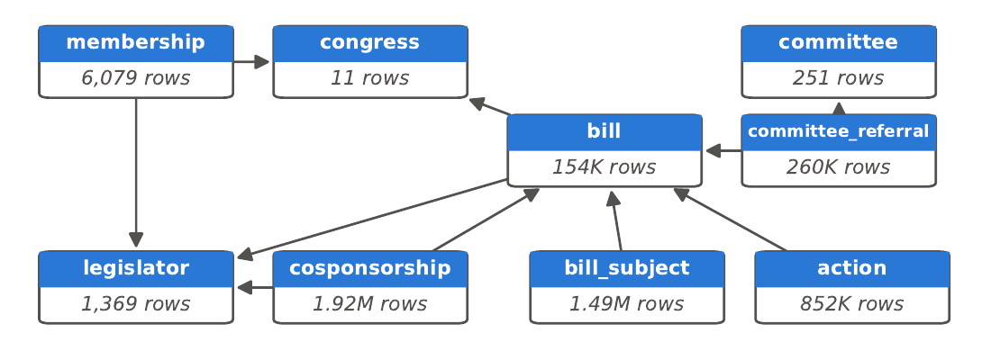
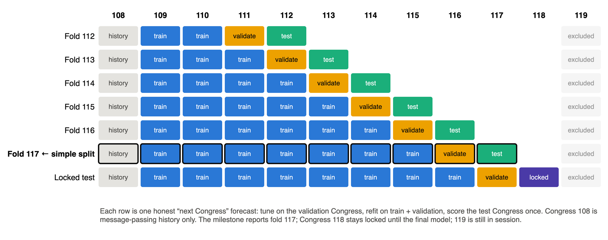
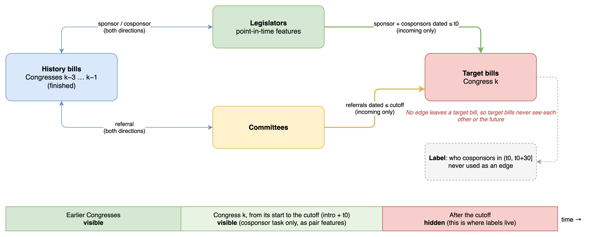
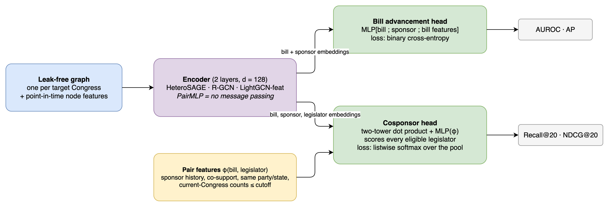

# Predicting Bill Advancement and Cosponsorship with Graph Deep Learning on Congress.gov Data

**Project milestone (first draft of the final report)** · CS224W, Fall 2026
Andrew Lawlor (`adlawlor@stanford.edu`) · Alex Rivas (`alex502@stanford.edu`)

> **TL;DR.** We turned 20 years of U.S. Congress records (Congresses 108–118, about 154,000 bills and 1.9 million cosponsorships) into a leak-free temporal graph. On it we set up two prediction tasks: **will a bill advance out of committee**, and **who will cosponsor it next**. This milestone establishes strong baselines for both: simple heuristics, a gradient-boosted tree, and three GNNs (HeteroSAGE, R-GCN, LightGCN). The GNNs beat every heuristic by about 30% on cosponsor prediction. On bill advancement, a tabular model on the bill's own features is as strong as the GNNs. The next phase of the project is to make the graph earn its keep.

---

## 1. Why this problem

Legislative staff, advocacy groups and government-affairs platforms (Quorum, FiscalNote, GovTrack) ask two questions every day: *which bills are going to move?* and *whom should we ask for support next?* Both answers are relational. In our data, 76.6% of cosponsorships are same-party, and 54.7% come from a legislator who had already backed the same sponsor earlier in that Congress. That makes Congress a natural, public, timestamped graph benchmark in the spirit of RelBench [5].

## 2. Data

### Sources

- **GovInfo BILLSTATUS bulk data** [9]: one XML record per bill, with its sponsor, cosponsors (and the date each signed on), committee referrals and every action. There are 173,437 files covering Congresses 108–119.
- **Congress.gov API** [8]: legislators per Congress (party, state, chamber, terms) and committee metadata. We fetched it with a rate-limited client.

We parsed everything with a Spark ETL into 21 Parquet tables partitioned by Congress. The schema and row counts are in Figure 1.

*Figure 1: Relational schema for Congresses 108–118 (row counts per table; arrows point from foreign key to primary key).*

### What we used, and how we cleaned it

| Step | What we did | Why |
|---|---|---|
| Time range | Congresses 108–118 (2003–2024); 119 excluded | 119 is still in session, so its outcomes are unknown |
| Bills | Law-capable types only: HR, S, HJRES, SJRES (128,791 bills) | Simple and concurrent resolutions cannot become law |
| Parsing | All 173,437 XML files parsed with 0 errors; 13 legacy-format files handled | Every record makes it into the tables |
| Cosponsorships | 1,771 withdrawn cosponsorships removed (1.92M remain) | A withdrawn signature is not support |
| Point-in-time facts | Party as of each Congress (99.9% agreement with the party printed on that Congress's bills); candidate pools = members in office at the prediction date | Legislators switch parties and chambers; using today's values would leak the future |
| Censoring | Drop bills whose label window runs past the end of their Congress | Bills die at adjournment, so their outcome can never be observed |
| Leaky fields | Never use legislative subjects, CRS summaries, later text versions, final counts (e.g. total cosponsors) or, for advancement, the policy area | These are written or updated *after* introduction and encode the outcome |

## 3. Tasks and metrics

We study two tasks on the same graph. Both are predicted **at the moment a bill is introduced** (prediction time *t0* = 0; cosponsor prediction also at *t0* = 7 days later), using only information dated on or before that moment.

### 3.1 Bill advancement (node classification)

**Question:** will a law-capable bill be **reported out of committee within 180 days** of introduction? Most bills never get that far: only 5.6% of the 110,802 uncensored bills do, and 2.8% in our test Congress.

**Metrics: AUROC (headline) and average precision (AP).**
- **Accuracy is useless here.** A model that predicts "no" for every bill is 97% accurate.
- **AUROC** is the probability that a random advancing bill is scored above a random stalled one. It needs no decision threshold, and it does not depend on the base rate, which varies between Congresses (from about 3% to 9%). That makes it the fairest number for comparing models across Congresses. Random = 0.5.
- **AP** focuses on the top of the ranking, which is what a user acting on the top predictions cares about. Random AP equals the positive rate (0.028), so it shows how far above chance a model is.
- In the proposal we named AP as primary. Our split study then showed the base rate drifts between Congresses, so we now lead with AUROC and always report AP next to it. Both metrics rank the baselines almost identically.

### 3.2 Cosponsor prediction (temporal link prediction)

**Question:** given a new bill, rank every legislator who could still sign on (same chamber, in office, not the sponsor, not already a cosponsor) by how likely they are to **cosponsor within the next 30 days**.

**Metric: Recall@20 (headline), plus Recall@10 and NDCG@20.**
- **It matches the use case.** Recall@20 is the share of a bill's true new cosponsors that appear in the model's top 20, a realistic shortlist for staff deciding whom to contact.
- **It treats bills equally.** It divides by the number of true cosponsors, so a bill with 1 new cosponsor counts as much as a bill with 30. Precision would be dominated by the popular bills.
- **It ranks the full pool.** We score all ~435 House members (or ~100 senators) for every bill, never a sampled subset, so the number reflects the real difficulty.
- **NDCG@20** additionally rewards putting the true cosponsors near the top of the list.

## 4. Evaluation protocol

### A temporal split by Congress

A random split leaks the future: 45% of evaluation bills would have a related bill introduced *later* sitting in the training set. A within-Congress split (as in Russo et al. [1]) leaves most late-session bills without an observable outcome. So we split **by whole Congresses, in time order**, as rolling "next Congress" forecasts (Figure 2).

**This milestone reports the simple split, fold 117:**
- train on 108–115 and validate on 116;
- retrain on 108–116 with the chosen settings, and test on 117.

All hyperparameters are chosen on validation only. Congress 118 is locked until the final model.

*Figure 2: Rolling-origin evaluation. Each row is one forecast of the next Congress. The milestone uses fold 117; the final report averages folds 112–117 and scores the locked Congress 118 once.*

### Graphs built as of the prediction time

Message passing over the full graph would let a bill "see" cosponsorships that happen after its prediction time. For every target Congress *k* we therefore build one graph (Figure 3):

- **History part.** Legislators, committees and the bills of the three previous Congresses, connected in both directions.
- **Target part.** Each new bill of Congress *k* is attached only through **incoming** edges dated on or before its cutoff: its sponsor, its cosponsors so far, and its committee referrals. No edge leaves a target bill, so target bills cannot see each other or the future.
- **Current-Congress signal.** For cosponsor prediction, what happened earlier in the same Congress (for example, how often a candidate has backed this sponsor this session) enters as leak-free pair features, computed exactly up to each bill's cutoff day.

Automated tests delete every event after a cutoff and confirm that no input changes, and a deliberately leaky feature is caught by the same test.

*Figure 3: Leak-free graph for target Congress k. History is bidirectional; target bills only receive edges dated before their cutoff; labels are never edges.*

## 5. Baselines

### Reference models (no message passing)

- **Heuristics:** popularity, same party, **sponsor history** (how often a legislator backed this sponsor before), and a **2-hop random walk**. For advancement: the historical report rate of the bill's committee.
- **Tabular models on the bill's own features:** gradient-boosted trees and logistic regression. They tell us how much signal exists without any graph.
- **PairMLP:** the GNN architecture with message passing switched off. Comparing the GNNs against it isolates what message passing adds.

### GNN baselines and why we chose them

| Model | Why it is a good baseline here |
|---|---|
| **HeteroSAGE** (GraphSAGE per relation, Hamilton et al. [10]) | *Inductive*: builds a node's representation from its features and neighbours, so it can score legislators and bills it never saw in training (13% of test cosponsors are new legislators). Mean aggregation keeps a prolific cosponsor and a freshman on the same scale. |
| **R-GCN** (Schlichtkrull et al. [3]) | Relation-specific weights for our 11 edge types, with basis decomposition (4 bases) to limit parameters; the encoder family used by the closest prior work on cosponsorship [1]. |
| **LightGCN-feat** (He et al. [11]) | Tests whether *learned* message passing is needed at all: fixed GCN-normalized diffusion of node features, followed by an MLP. It's a strong, cheap recommender-system baseline. |

We did not use **GIN**: it targets whole-graph classification, where its extra expressive power matters, not feature-rich link and node prediction. **HGT** is our candidate for the improved model.

All three GNNs share the same input encoders and output heads (Figure 4). That way, a difference in results comes from the message passing alone.

*Figure 4: Shared pipeline. One encoder per model; a node head for advancement and a link head (two-tower dot product plus a pair-feature MLP) for cosponsor prediction.*

### Training recipe

| Choice | Setting | Reason |
|---|---|---|
| Cosponsor loss | Listwise softmax over each bill's **full** eligible pool | Optimizes the ranking directly; no negative sampling needed, and the pool already contains hard negatives (same party, same state). BPR was 0.003–0.005 Recall@20 worse. |
| Advancement loss | Binary cross-entropy, no class weights | AUROC and AP are rank-based, so reweighting does not help |
| Optimizer | AdamW, lr 3e-3 (1e-3 for LightGCN), weight decay 1e-4, gradient clipping at 1.0 | Standard for small GNNs; as in [1] |
| Schedule | 5% warmup, then cosine decay | Stable training on a few large graphs |
| Architecture | 2 layers, hidden size 128, dropout 0.2, DropEdge 0.1 | Two hops cover legislator → bill → legislator; deeper did not help |
| Model selection | Early stopping on the validation Congress (3-epoch moving average), then refit on train + validation for the same number of epochs | Uses validation only; test is scored once |
| Robustness | 3 seeds; paired bootstrap CIs over sponsors | Single-seed differences below about 0.01 are noise |

Graphs are trained full-batch, one graph per Congress. PyG's neighbour sampler needs compiled extensions we chose not to require, and a full-batch layer over 2M edges takes about 0.1 s on a laptop CPU. The whole baseline notebook runs in about 12 minutes on CPU.

## 6. Results: bill advancement

Test Congress 117 has 12,953 bills, 2.8% positive. Learned models show the mean over 3 seeds; brackets are 95% bootstrap CIs.

| Model | Validation AUROC (116) | Test AUROC (117) | Test AP |
|---|---|---|---|
| Prior (random) | 0.500 | 0.500 | 0.028 |
| Committee report rate (heuristic) | 0.771 | 0.726 [0.688, 0.761] | 0.079 |
| Logistic regression (bill features) | 0.771 | 0.797 [0.765, 0.824] | 0.128 |
| Gradient-boosted trees (bill features) | 0.792 | 0.820 [0.792, 0.846] | 0.152 |
| PairMLP (no message passing) | 0.792 | 0.801 [0.768, 0.829] | 0.135 |
| HeteroSAGE | 0.801 | 0.805 [0.770, 0.833] | 0.151 |
| R-GCN | 0.804 | 0.810 [0.776, 0.838] | 0.154 |
| **LightGCN-feat** | 0.801 | **0.825** [0.797, 0.850] | **0.162** |
| Kumo Relational | *to be added* | | |

**What this shows.** The learned models clearly beat the heuristics (+0.08 AUROC over the committee report rate). But most of the signal sits in the bill's own features: who sponsors it, which committees it goes to, and how many original cosponsors it has. Gradient-boosted trees on those features alone reach 0.820. HeteroSAGE and R-GCN do not beat them, and LightGCN only ties them (+0.005, within noise). For this task, a tabular model is the bar the graph has to clear.

### 6.1 Kumo Relational baseline (in progress)

*Placeholder for the Kumo Relational foundation-model baseline [6, 7], run by our teammate.* For a fair comparison it must use the same definitions as the table above:
- **Label:** reported out of committee within 180 days.
- **Population:** HR, S, HJRES and SJRES bills.
- **Split:** train 108–115, validate 116, test 117.
- **Censoring:** censored bills dropped, leaving 12,953 test bills.
- **Prediction time:** the bill's introduction date, with no later information.

Results and per-bill predictions (for paired CIs) will be added here.

## 7. Results: cosponsor prediction

Prediction at introduction (*t0* = 0). Test Congress 117 has 5,101 bills with at least one new cosponsor. Learned models show the mean over 3 seeds.

| Model | Val Recall@20 (116) | Test Recall@20 (117) | Test Recall@10 | Test NDCG@20 |
|---|---|---|---|---|
| Party + popularity | 0.204 | 0.191 [0.174, 0.208] | 0.113 | 0.115 |
| Sponsor history (earlier Congresses only) | 0.254 | 0.262 [0.245, 0.279] | 0.173 | 0.166 |
| Learned embeddings (SVD) | 0.276 | 0.283 [0.265, 0.303] | 0.191 | 0.182 |
| Sponsor history (+ current Congress) | 0.288 | 0.307 [0.291, 0.325] | 0.204 | 0.193 |
| 2-hop random walk (+ current Congress) | 0.286 | 0.308 [0.291, 0.325] | 0.199 | 0.192 |
| PairMLP (no message passing) | 0.367 | 0.386 [0.369, 0.407] | 0.251 | 0.241 |
| HeteroSAGE | 0.375 | 0.393 [0.374, 0.414] | 0.254 | 0.245 |
| R-GCN | 0.374 | 0.394 [0.375, 0.415] | 0.257 | 0.245 |
| **LightGCN-feat** | 0.371 | **0.400** [0.381, 0.420] | **0.260** | **0.249** |

**What this shows.**
- **Every GNN beats the best heuristic by about 0.09 Recall@20**, roughly 30% better. In practice, the model's top 20 contains about 40% of a bill's future cosponsors, against 31% for the best heuristic.
- **Most of the gain is already in PairMLP.** That gain comes from learning to combine leak-free pair features (sponsor history, co-support, same-session activity) with point-in-time legislator features.
- **Message passing adds little so far.** Only LightGCN clearly beats PairMLP (+0.013 over 3 seeds); the three GNNs cannot be ranked against each other.
- **New legislators** (13% of test cosponsors) are found in the top 20 about 23% of the time by the learned models, against 5% for the heuristics. That is the payoff of inductive features.

## 8. Next steps

1. **Make message passing matter.** Try HGT, and give the encoder more of what the heuristics already exploit: time-aware edges and attention over relation types. Measure each gain against PairMLP and gradient-boosted trees, not only the heuristics.
2. **Answer the research question** for cosponsor prediction: how much does the first week of support help? Compare predicting at day 0 with predicting at day 7.
3. **Run the full protocol:** six rolling folds (112–117) with paired tests, then score the locked Congress 118 once.
4. **Ablations:** remove edge types (committees, history bills), and break results down by party, chamber and new vs returning legislators.
5. **Add the Kumo Relational baseline** for bill advancement (Section 6.1).

## Code

- `data_processing/`: data download (`bulk_bill_download.sh`, `fetch_congress.py`) and the Spark ETL (`parsers.py`).
- `notebooks/01_split_analysis.ipynb`: evidence for the split.
- `notebooks/02_baselines.ipynb`: every baseline in this report. Run instructions are in `docs/BASELINES_RUN.md`, and every model, loss and hyperparameter choice is documented in `docs/BASELINES.md`.

## References

[1] Russo, G., et al. (2023) Helping a friend or supporting a cause? Disentangling active and passive cosponsorship in the U.S. Congress. *ACL 2023*, pp. 2952–2969.
[2] Sotoudeh, S., et al. (2026) A network-based measure of cosponsorship influence on bill passage in the United States House of Representatives. *EPJ Data Science*.
[3] Schlichtkrull, M., et al. (2018) Modeling relational data with graph convolutional networks. *The Semantic Web*, pp. 593–607.
[4] Fey, M., et al. (2023) Relational deep learning: Graph representation learning on relational databases. *arXiv:2312.04615*.
[5] Robinson, J., et al. (2024) RelBench: A benchmark for deep learning on relational databases. *arXiv:2407.20060*.
[6] Hudovernik, V., et al. (2026) KumoRFM-2: Scaling foundation models for relational learning. *arXiv:2604.12596*.
[7] NVIDIA (2026) Kumo Relational model card, version 1.0.0.
[8] Library of Congress. Congress.gov API. https://github.com/LibraryOfCongress/api.congress.gov
[9] U.S. Government Publishing Office. GovInfo bulk data repository. https://www.govinfo.gov/bulkdata
[10] Hamilton, W., Ying, R. & Leskovec, J. (2017) Inductive representation learning on large graphs. *NeurIPS*.
[11] He, X., et al. (2020) LightGCN: Simplifying and powering graph convolution network for recommendation. *SIGIR*.
