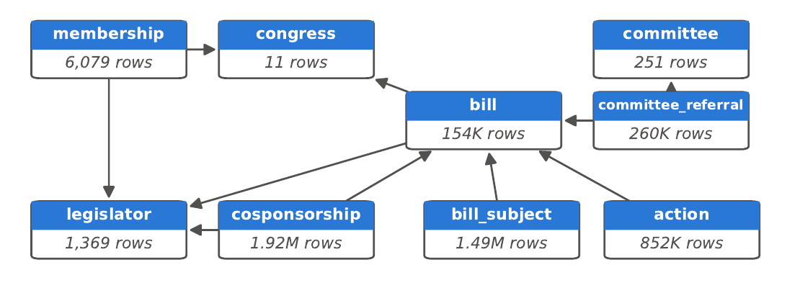

# Project Proposal - CS224W - Fall 2026
# Predicting Bill Cosponsorship and Advancement using Graph Deep Learning with Congress.gov Data

**Andrew Lawlor**, Department of Computer Science, Stanford University, `adlawlor@stanford.edu`
**Alex Rivas**, Department of Computer Science, Stanford University, `alex502@stanford.edu`

---

## 1 Dataset

Figure 1 shows the relational schema with row counts. We will use public legislative data from the U.S. Congress, obtained through the Congress.gov API [8] and the official bulk bill-status files published by GovInfo [9]. We restructure the records for the 11 most recent completed Congresses (108th–118th, 2003–2024) into a relational database shown on figure 1. The 119th Congress is still in session, so its outcomes are not yet known and we exclude it. The processed tables contain about 154,000 bills and 1.9 million cosponsorship events. The data is public, and we will release the processed tables and our download and parsing scripts so the Colab is fully reproducible.

**Why this dataset.** Deciding whom to ask for support next, and which bills are likely to move, is a daily question for legislative staff, advocacy groups, and government-affairs platforms such as Quorum, FiscalNote, and GovTrack, which publishes a prognosis for every bill. Support is relational: 76.6% of cosponsorships in our data are same-party, and 54.7% come from a legislator who had already cosponsored one of the same sponsor's bills earlier in that Congress, while committees and subjects link bills that share no cosponsors. The data is public, timestamped at the level of individual events, naturally multi-table, and spans several changes in party control, which makes it a realistic temporal relational benchmark in the style of RelBench [5].

We will load the Congress.gov data [8] into a relational database (for example, BigQuery) for processing and publish the final tables as Parquet files, so that our Colab can reproduce all results without requiring cloud access.

*Figure 1: Relational schema for Congresses 108–118. Each box is a table with its row count; arrows point from a foreign key to the primary key it references.*

Bill text is also available: GovInfo publishes the full text of every bill version from the 113th Congress on [9], and the bill-status files include CRS-written summaries. We do not plan to use either, because of potential leakage: later text versions (e.g., as reported or as passed) and summaries are written as a bill advances, so they can encode the very outcomes we are trying to predict.

Bill volume and cross-party cosponsorship change across Congresses, which motivates splitting train, validation, and test sets by Congress. If the full graph is too large to train comfortably in Colab, we can keep only the last two or three Congresses.

## 2 Tasks

### 2.1 Bill Cosponsor Prediction

Every bill has one sponsor, the member who introduces it, and zero or more cosponsors, each with the date they signed on, so cosponsorship is a temporal link prediction task. Given a bill at prediction time $t$ (days since introduction), we rank the legislators who could still cosponsor it: members of the bill's chamber serving in that Congress at $t$, excluding the sponsor and current cosponsors. Positives are the legislators whose cosponsorship date falls in $(t, t + 30]$. At test time we rank all eligible candidates rather than sampled negatives, evaluate only bills with at least one positive, and drop bills whose 30-day window extends past the end of the Congress.

**Research question.** Prior work models cosponsorship with relational GNNs over bill text and floor speeches [1], or relates cosponsorship networks to bill passage [2]. We ask how much early support reveals about later support, by comparing two prediction times: at introduction ($t = 0$, once the original cosponsors are known, predicting days 1–30) and one week later ($t = 7$, predicting days 8–37). Both settings have enough signal: 41.6% of cosponsorships are original and 49.3% are in by day 7, a A third of bills (34.2%) gain at least one new cosponsor in days 1–30, and 29.5% in days 8–37, so both settings leave enough bills to evaluate.

We evaluate cosponsor prediction with the ranking metrics in Table 1, at $K \in \{10, 20\}$.

| Metric | Definition (per bill) |
|---|---|
| Recall@$K$ | $\lvert \mathrm{Rel} \cap \mathrm{Top}_K \rvert \,/\, \lvert \mathrm{Rel} \rvert$ |
| MAP@$K$ | $\frac{1}{\min(\lvert \mathrm{Rel} \rvert, K)} \sum_{i=1}^{K} P@i \cdot \mathrm{rel}_i$ |
| NDCG@$K$ | $\sum_{i=1}^{K} \frac{\mathrm{rel}_i}{\log_2(i+1)} \Big/ \mathrm{IDCG}@K$ |

*Table 1: Cosponsor ranking metrics. Rel is the set of true cosponsors, $\mathrm{rel}_i \in \{0, 1\}$ marks a hit at rank $i$, and $P@i$ is precision at rank $i$.*

We compare against a global popularity ranking, a same-party heuristic, a sponsor-history baseline (past cosponsorships of the same sponsor's bills), and a gradient-boosted tree model trained on hand-engineered features flattened into a single table, following [4,5], as shown in Table 2

As an optional third task, we will predict whether a bill receives at least one cross-party cosponsor. 59.6% of bills with cosponsors do, so this label is roughly balanced.

| Baseline | Ranks legislators by |
|---|---|
| Popularity | overall cosponsoring rate |
| Same-party | sponsor's party, then popularity |
| Sponsor history | past cosponsoring of the sponsor's bills |
| Boosted trees | engineered features, flattened to one table |

*Table 2: Baselines for cosponsor prediction.*

### 2.2 Bill Advancement Prediction

Most bills never leave committee. We cast advancement as binary entity classification: will a bill (HR, S, HJRES, or SJRES, the types that can become law) be reported out of committee within 180 days of introduction, using only information available at introduction? We drop bills introduced less than 180 days before the Congress ends, because unpassed bills expire at adjournment and their labels would be censored. Of the remaining 110,802 bills, 5.6% are positive (3.1% within 90 days and 8.1% within 365 under the same rule). Many House bills pass under suspension of the rules without a committee report, so we will also test the variant label "reported or passed a chamber." Given the imbalance, we report average precision as the primary metric, together with AUROC.

## 3 Graph ML Techniques

We will capture the Congress.gov tables as a Heterogeneous relational entity graph in RDL style. Rows become nodes: Legislators, bills, committees, subjects, actions. Foreign keys become edges: Sponsors, cosponsors, referred-to, has-subject. We will make temporal predictions by sampling neighbors only from before the prediction time to prevent 'leakage'.

The main model will be a heterogeneous GNN in PyG. We will use R-GCN [3] as our baseline GNN. Our encoder will embed each node type's features (party, chamber, state, dates) into a shared dimension before message passing.

The R-GCN update is:

$$
h_i^{(l+1)} = \sigma\left( W_0^{(l)} h_i^{(l)} + \sum_{r \in \mathcal{R}} \sum_{j \in \mathcal{N}_i^{r}} \frac{1}{c_{i,r}} W_r^{(l)} h_j^{(l)} \right) \tag{1}
$$

where $h_i^{(l)}$ is the representation of node $i$ at layer $l$, $\mathcal{R}$ is the set of relation types, $\mathcal{N}_i^{r}$ are the neighbors of $i$ under relation $r$, $c_{i,r} = \lvert \mathcal{N}_i^{r} \rvert$ is a normalizer, $W_r^{(l)}$ is a relation-specific weight matrix, $W_0^{(l)}$ is the self-connection weight, and $\sigma$ is a nonlinearity such as ReLU [3].

Cosponsor prediction is a temporal link prediction task. The decoder scores a (bill, legislator) pair, with a dot product or MLP on the two embeddings. We will train with sampled negatives and a BCE or ranking loss. Bill advancement is binary node classification on the bill embedding with a sigmoid output.

We will compare R-GCN vs HGT vs boosted trees. We will perform ablation studies by removing edge types or timestamps and measure performance by party, chamber or Congress. We will optionally compare to Kumo Relational baseline, depending on access.

## References

The following papers relate to our paper's task on the Congress.gov dataset.

[1] Russo, G., et al. (2023) Helping a friend or supporting a cause? Disentangling active and passive cosponsorship in the U.S. Congress. In A. Rogers, J. Boyd-Graber and N. Okazaki (eds.), *Proceedings of the 61st Annual Meeting of the Association for Computational Linguistics (Volume 1: Long Papers)*, pp. 2952–2969. Toronto, Canada: Association for Computational Linguistics.

[2] Sotoudeh, S., et al. (2026) A network-based measure of cosponsorship influence on bill passage in the United States House of Representatives. *EPJ Data Science*. https://doi.org/10.1140/epjds/s13688-026-00689-4

[3] Schlichtkrull, M., et al. (2018) Modeling relational data with graph convolutional networks. In *The Semantic Web*, pp. 593–607. Cham: Springer International Publishing.

[4] Fey, M., Hu, W., Huang, K., Lenssen, J.E., Ranjan, R., Robinson, J., Ying, R., You, J. & Leskovec, J. (2023) Relational deep learning: Graph representation learning on relational databases. *arXiv preprint arXiv:2312.04615*.

[5] Robinson, J., Ranjan, R., Hu, W., Huang, K., Han, J., Dobles, A., Fey, M., Lenssen, J.E., Yuan, Y., Zhang, Z., He, X. & Leskovec, J. (2024) RelBench: A benchmark for deep learning on relational databases. *arXiv preprint arXiv:2407.20060*.

[6] Hudovernik, V., López, F., Kocijan, V., Nitta, A., Lenssen, J.E., Leskovec, J. & Fey, M. (2026) KumoRFM-2: Scaling foundation models for relational learning. *arXiv preprint arXiv:2604.12596*.

[7] NVIDIA (2026) Kumo Relational model card, version 1.0.0. https://build.nvidia.com/nvidia/kumo-relational/modelcard

[8] Library of Congress. Congress.gov API. https://github.com/LibraryOfCongress/api.congress.gov

[9] U.S. Government Publishing Office. GovInfo bulk data repository. https://www.govinfo.gov/bulkdata
